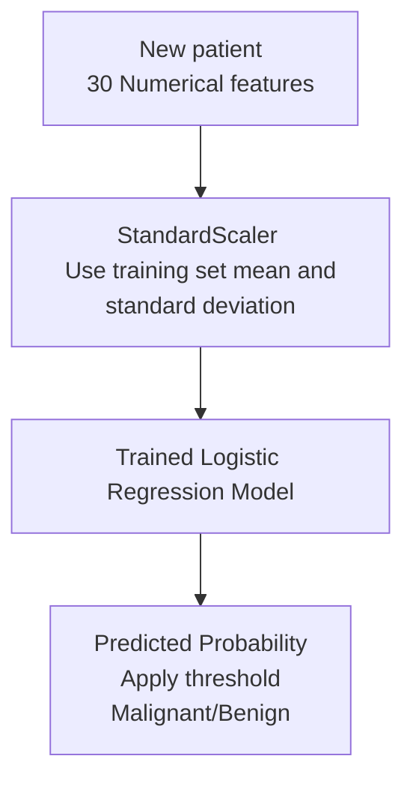

# Wisconsin Breast Cancer problem
**Problem**: Classify a breast cancer is malignant or benign  
**Patterns**: Numerical properties of the cell nuclei  
**Dataset Source**: Scikit-Learn

### Dataset Properties
**Source**:    
**Observations**: 569  
**Input Variables**: 30 numerical features  
**Prediction Target**: Benign or Malignant (0 or 1)  
**Problem Type**: Supervise Binary Classification  

### ML Problem
This is a supervised classification problem  
The model will take the tumor cell properties as input and classifies whether those belong to benign or malignant cell.   
*Note: The input features are obtained by processing cancer cell images. However, those images are not part of the dataset.*  

**Interview Question:**  
*Question: Why would you select Logistic Regression instead of Linear Regression for this problem?*  
*Answer: Logistic Regression is appropriate because our target is binary. It models the probability of belonging to a class and uses a decision threshold to make predictions.*  

###  Dataset Variables
**X** : about 30 tumor cell features (Some of the cell characteristics are given by its radius, texture, perimeter, area, and smoothness.)  
**y** : binary labels (1: malignment, 0: benign)  

### Training Set
**X** : Feature matrix (569, 30)  
**y** : Target vector (569,)  

We will have 80-20 split for training and testing as the training set is small. The more the data used to training the better the model learning 
**X_train**: 455 observations (415, 30)  
**y_train**: 455 observations (415, )  
**X_test**: 114 observations (114, 30)  
**y_test**: 114 observations (114, )  

**Interview Question**  
*Question:   
Should we normalize or standardize these features before training Logistic Regression? Why or why not?*  
*Answer:  
But I would recommend standardization over normalization for Logistic Regression.   Features with larger numerical values scales can disproportionately affect optimization, particularly when regularization is used.  *
**Normalization (Min-Max): Result [0, 1]** 
$$
\frac{x-x_{min}}{x_{max}-x_{min}}  
$$ 

**Standardization (Z-score): Result [Mean= 0, Std =1]**   
$$
\frac{x-\mu}{\sigma}
$$
*Note: We can use **5-fold cross-validation** on the training set for hyperparameter tuning. We also need stratified splitting to preserve the **malignant/benign** class proportions*

### Logistic Regression Mathematics
We use sigmoid function for this which projects results between 0 and 1. 
$$
\sigma (z) = \frac{1}{1 + e^{-z}}
$$
where
$$
\hat{z} = \beta_0 + \sum^{30}_{j=1}\beta_j x_j
$$
- $x_1, \ldots, x_30$: 30 input features, such as radius, texture, perimeter, and smoothness.
- $\beta_0, \ldots, \beta_30$: Parameters learned during training.

$$
\hat{y} = \begin{cases} 
1 & \text{if } \sigma(z) \ge \tau \\ 
0 & \text{otherwise} 
\end{cases}
$$
- $\hat{y}$: Predicted binary value (1: benign or 0: malignant).
- $\tau$: Threshold for the classification

## Loss function
Binary Cross Entropy (BCE): 
- This loss function is derived from Bernoulli likelihood, appropriate for binary outcomes.
- It heavily penalizes confident, incorrect predictions.
- For Logistic regression, BCE is convex with respect to the model coefficients, making optimization more reliable.

$$
\boxed{L = -\frac{1}{N} \sum_{i=1}^{N} \left[ y_i \log(p_i) + (1 - y_i) \log(1 - p_i) \right]}
$$

## Parameter update

Calculate gradients using the chain rule:

$$
\boxed{\frac{\partial L}{\partial \beta_j} = \frac{1}{N} \sum_{i=1}^{N} (\hat{y}_i - y_i) x_{ij}}
$$

Update coefficients using gradient descent:

$$
\boxed{\beta_j^{\text{new}} = \beta_j^{\text{old}} - \alpha \frac{\partial L}{\partial \beta_j}}
$$

Here, $\alpha$ is the learning rate. 

## Evaluation

For this problem, we will focus on false positive (FP) and false negative (FN).

**FP**: A benign tumor is predicted as malignant  
**FN**: A malignant tumor is predicted as benign  

In this higher **FN** is more dangerous as we cannot classify malignant tumor as benign which may have serious implications.

So **FN**, which can be characterized by **Recall** is particularly important. 

$$
\boxed{Recall = \frac{TP}{TP+FN}}
$$

Higher recall means fewer malignant cases are missed.  
For cancer screening, recall (sensitivity) is especially important because false negatives can delay diagnosis. Accuracy alone may hide dangerous errors.

**Interview Question**  
*Suppose we lower the classification threshold from 0.5 to 0.3 for malignant tumors.  
**Q**: What generally happens to recall and precision?   
**A**: Recall increases, precision may decrease.* 

## Inference pipeline

We have trained and evaluated our logistic regression model. Now consider a new patient whose tumor measurements were not part of the training dataset. 

**Interview Question**  
**Q**:*During inference which mean and standard deviation we should use to scale the test data?*   
**A**: *Fit the scaler on training data only. Reuse that fitted scaler during validation, testing, and inference.*