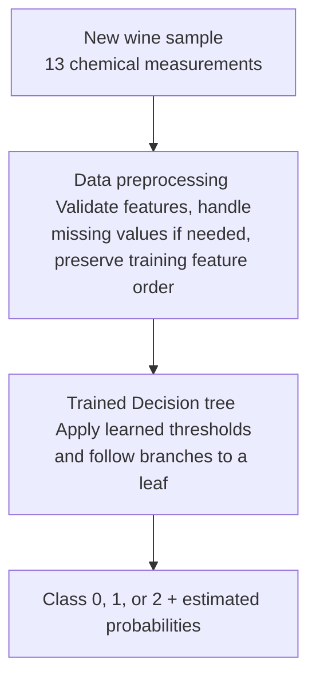

# UCI Wine multi-class Problem
**Problem**: Classify if the wine belongs to one of three classes  
**Patterns**: Chemical measurements such as alcohol, malic acid, magnesium, and color intensity  
**Dataset Source**: Scikit-Learn  

### Dataset Properties
**Source**: UCI wine dataset  
**Observations**: 178 wines  
**Input Variables**: 13 numerical chemical properties  
**Prediction Target**: Wine Class (3 categories)  
**Problem Type**: Multiclass Classification

### ML Problem
This is a supervise multiclass classification problem  
The model takes chemical measurements as input and classifies whether those belong to one of the three classes of wine  
We are using **Decision Trees** for this multiclass problem  

**Interview Question:**  
*Question: Why might you choose a Decision Tree instead of Logistic Regression for this problem?*
*Answer: 
**Interpretability**: Decision Trees provide understandable rules for classifying wines.  
**Feature interactions**: Trees can capture interactions between chemical measurements.  
**Small dataset**: Trees can work with small datasets, although they are prone to overfitting.  
**Nonlinearity**: They can capture nonlinear decision boundaries without explicitly engineering nonlinear features.  

**Interview Question:**  
*Suppose two features are: Alcohol content and Color intensity* 
*A decision tree might use rules such as:  *
*Alcohol > 13.0 --> one branch*  
*Color intensity > 5.0 --> another branch*  
*Question: How do you think a Decision Tree decides which feature to split on first?*  
*Answer: The decision tries to identify the features that best separates the wine classes.It uses the following:*  
**Gini Impurity**: *Measures how mixed the classes are*
**Entropy / Information Gain**: *Measures how much uncertainty is reduced after splitting*  
**Simple example**:  
*- Suppose we have 100 wines belonging to three classes.*  
*Candidate split Result:*  
*- Alcohol > 13	Two groups, each containing mostly one class*  
*- Color intensity > 5	Two groups, each containing a mixture of all three classes*  
*- The tree would generally prefer the Alcohol split, because it produces purer groups.*  
***One important distinction**: the tree evaluates both the feature and its threshold, not just the feature itself.*  

### Dataset variables
**X**: about 13 chemical features (some of the features are alcohol level, malic acid, magnesium, and color intensity.)  
**y**: class labels (0, 1, 2)  

### Training Set 
**X**: Feature matrix (178, 13)  
**y**: Target matrix (178, 3)  

We will have 80-20 split for training and test data. In addition, we will have 5-fold stratified cross-validation on the training set.  

*Interview Question:*  
*Suppose our Decision Tree achieves:*  
*- Training accuracy: 100%*  
*- Test accuracy: 75%*  
*Question: What does this suggest about the Decision Tree, and what would you do to improve its performance?*  
*Answer: This suggests that we have overfitting in the model. We should do hyperparameter tuning. Such as:*  
*- max_depth - Limits how deep the tree can grow*  
*- min_samples_split - Minimum number of samples required to split a node*  
*- min_samples_leaf  - Minimum samples required in a leaf*  

### Decision Tree Algorithm & Mathematics

Let's understand **Gini impurity**, one of the criteria used to select the best split. The formula is:  
$$
Gini = 1 - \sum_{i=1}^{C}p_i^2
$$
*where, C = Number of classes, p_i = Proportion of samples belonging to class i.*

*Example: Suppose a node contains 10 wines  *
*- Class 0: 5 wines*  
*- Class 1: 3 wines*  
*- Class 2: 2 wines*  
**Gini** = 1 - 0.5^2 - 0.3^2 - 0.2^2 = 0.62 

**Note**: A Gini value of 0 means the node is perfectly pure.  

**How does a Decision Tree select the best split?**  
*The algorithm calculates the **weighted Gini Impurity** of the two child nodes:*
$$
{Gini}_{split} = \frac{N_L}{N}{Gini}_L + \frac{N_R}{N}{Gini}_R
$$
*where: N_L, N_R are the number of samples in the left and right children. N are the total samples in the parent node. {Gini}_L, {Gini}_R are Gini impurity of each child.  
*The algorithm prefers the split with the **lowest weighted Gini Impurity***  
**How does decision tree learn?**  
*During training, a Decision Tree:  *
*- Evaluates candidate features and split thresholds.  *
*- Calculates the weighted Gini impurity for each split.  *
*- select the split with the lowest impurity.  *
*- Repeats recursively until a stopping condition is reached.  *

*Interview Question:  *
*Unlike Linear Regression and Logistic Regression, Decision Trees do not use gradient descent or backpropagation for standard training.*  
*Question: Why do you think a Decision Tree doesn't need gradient descent?*  
*Answer: In traditional neural networks, we have parameters that decide the outcome. This parameters are updated to achieve desired output using loss function and backpropagation. Whereas in decision tree, there are no parameters but we have decisions at each node. To be precise, we the decision tree learns features and thresholds through minimizing split impurity, using greedy recursive splitting. The learning process selects the best split at each node.*  

**Leaf nodes:** *A leaf can contain all the classes of the problem. A new data reaching that leaf is assigned to the class with highest probability.*

### Loss Function

***Gini impurity** is used as the splitting criterion. It chooses the split that minimizes the weighted impurity of its children. Unlike neural networks, decision tress does not minimize one global differentiable loss through backpropagation.*

### Model Output and Evaluation

*Our wine dataset has three classes, so this is a multiclass classification problem.  *
*We can evaluate our Decision Tree using:  *
*- **Accuracy**: Overall percentage of correctly classified wines*  
*- **Precision**: How many predictions of a particular class were correct*  
*- **Recall**: How many actual wines of a particular class were correctly identified*  
*- **F1-score**: Harmonic mean of precision and recall*  
*- **Confusion Matrix**: Shows correct predictions and misclassifications across all three classes*  

### Inference Pipeline

*We have trained a Decision Tree using 13 chemical features to classify wines into three categories.  *

**Final Take**: *Unlike logistic regression, a Decision Tree does not generally require feature scaling.*