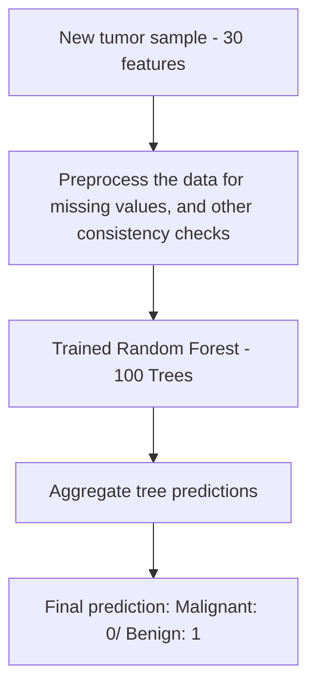

# Wisconsin Breast Cancer Problem
**Problem**: We have to classify whether the tumor is benign or malignant  
**Patterns**: Tumor cell characteristics like radii, color intensity, perimeter, and area.  
**Dataset Source**: Scikit-learn

### Dataset Properties
**Source**: Wisconsin Breast Cancer data  
**Observations**: 569  
**Input Variables**: 30 numerical features  
**Prediction Target**: Benign (1) or Malignant(0)  
**Problem Task**: Binary Classifier  

### ML Problem
This is *supervise binary classifier* problem.  
The model will take the tumor cell characteristics like cell radii, perimeter, area, its color intensity, as such about 30 features.  
The model has to classify whether it is malignant or benign tumor.  

Here, we propose to solve this using **Random Forest Classifier**.  
Why we are trying **Random Forest Classifier** over **Decision Tree**?  
A decision tree which aims to train a single tree can overfit the data. Where as in Random Forest, the model aims to train multiple decision trees and aggregates the results based on the selection process. This improves stability and generalization. The randomness helps make the trees less correlated, improving the ensemble's stability. 

We have 30 input features. Does decision tree in Random forest use all 30 features, or only a subset?  
In a standard RF classifier:  
- Each tree generally has access to all **30 features**  
- However, at **each split**, the algorithm considers only a **random subset of features**  
- With scikit-learn's default max_features = "sqrt", approximately sqrt(30) ~ 5 features are considered at each split  

### Dataset Variables
**X**: tumor cell characteristics like cell radii, perimeter, area, its color intensity, as such about 30 features.  
**y**: malignant or benign.  

### Training set
**X**: Feature matrix (569, 30)  
**y**: Target vector (569, )  

We will have 80-20 split for training and testing  
**X_train**: 455 observations (455, 8)  
**y_train**: 455 observations (455, )  
**X_test**: 114 observations (114, 8)  
**y_test**: 114 observations (114, )   

### Random Forest: Algorithm and Mathematics
The random forest extends the **Decision Tree algorithm** and its concepts like *Gini impurity*. For Decision Tree understanding check out Day 3 ML algorithms ReadMe.md file.  

Random Forest Extends it through three operations:  
- **Bootstrap Sampling**: Each tree trains on a random sample of training observations, sampled with replacement.
- **Random Feature Selection**: At each split, only a subset of features is considered.
- **Aggregation**: For classification, predictions from the trees are combined through voting. 

**Mathematical Representation**   
For *n* trees in the model, each tree predicts a class:
$$
h_1(x), h_2(x), \ldots, h_n(x) 
$$
The Random Forest prediction is 
$$
\hat{y} = mode\{h_1(x), h_2(x), \ldots, h_n(x)\}
$$
Here, *mode* represents the majority-voted class.

### Metrics 
Accuracy (overall correct predictions)  
Precision (Reliability of positive predictions)  
Recall (Fraction of actual positives detected)  
F1-score (Balance between precision and recall)  
Confusion matrix (TP, TN, FP, FN)  

## Inference Pipeline

The inference pipeline takes a new tumor cell features (30), preprocess it and predicts the results.

